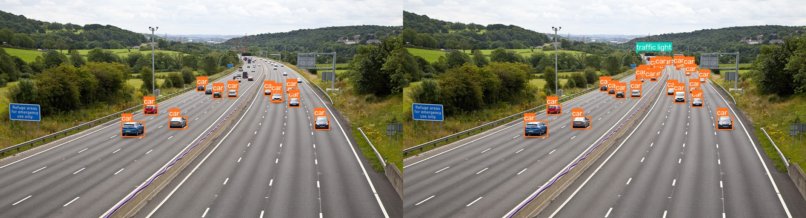
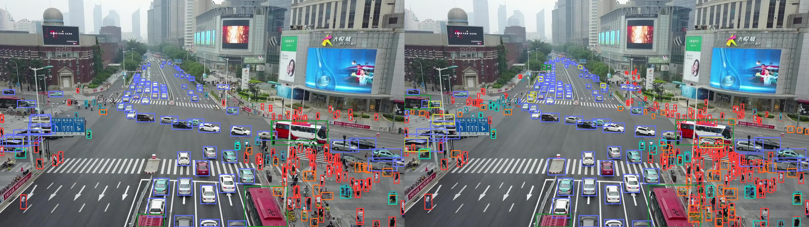
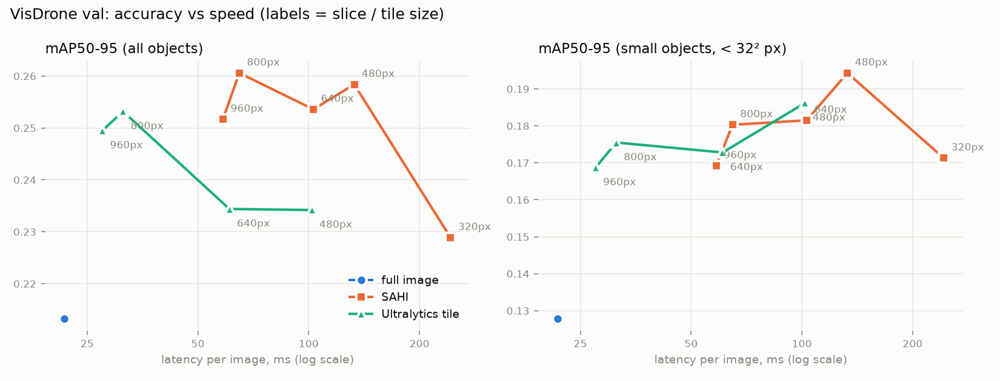

# Small-Object Detection in Aerial Imagery with SAHI

Standard YOLO inference downsizes large images to ~640 px, so small objects (cars, people seen from a drone)
shrink to a few pixels and get missed. **SAHI** (Slicing Aided Hyper Inference) runs the detector on
overlapping tiles and merges the results, recovering those objects without retraining.

This project measures that trade-off: **how much recall SAHI buys, and what it costs in latency.**

**Result:** on VisDrone val, SAHI raises small-object mAP50-95 by **+52%** (0.128 to 0.194) and small-object
recall from 0.198 to 0.335 with a YOLO26s fine-tuned on VisDrone, at about 6x the latency. With 800 px slices, it
raises overall mAP50-95 by +23% at 3x the latency.


*COCO-pretrained YOLO26n. Left: full image (12 detections). Right: SAHI 256 px slices (27 detections).*

### Dense scene, VisDrone val (fine-tuned YOLO26s, conf 0.25)


*This is the val image where SAHI helped most. Left: full image found 160 of 317 ground-truth objects (IoU ≥ 0.5). Right: SAHI with 480 px slices found 257, mostly the pedestrians and bicycles at the back of the scene.*

## What this project shows

- **Training:** fine-tuned YOLO26s on VisDrone2019-DET (6.5k images, 10 classes), with early stopping.
- **Evaluation:** one shared COCO evaluation for every inference strategy, set up so that dense scenes are not under-scored (maxDets 1000; VisDrone images have up to 900 objects).
- **Analysis:** an accuracy/latency sweep across 10 configurations, with each result explained by object size.
- **Demo:** a Gradio app to compare the strategies interactively.

## Setup

```bash
python -m venv .venv
.venv/Scripts/pip install torch torchvision --index-url https://download.pytorch.org/whl/cu128
.venv/Scripts/pip install -r requirements.txt
```

## Quick demo: standard vs sliced

```bash
.venv/Scripts/python scripts/compare.py
```

Downloads two SAHI demo images to `data/demo/`, runs both modes, and writes side-by-side visuals plus
`outputs/compare/results.md` (detections and ms per image). Use `--source <folder>` for your own images.

## Fine-tune on VisDrone

```bash
.venv/Scripts/python scripts/train.py                                        # full run (YOLO26s, 100 epochs, 640 px)
.venv/Scripts/python scripts/train.py --epochs 1 --fraction 0.05 --name smoke  # quick pipeline check
```

First run downloads VisDrone2019-DET (~2 GB) into `data/VisDrone/`. Weights and curves go to `runs/<name>/`.

## Evaluate: full image vs SAHI vs Ultralytics `tile`

```bash
.venv/Scripts/python scripts/evaluate.py --limit 20     # quick check
.venv/Scripts/python scripts/evaluate.py                # full val, all modes (~30 min)
.venv/Scripts/python scripts/plot.py outputs/eval/results_val.csv
```

All modes are scored with the same pycocotools COCOeval (conf 0.05, maxDets 1000), so numbers compare directly.

## Interactive demo

```bash
.venv/Scripts/python app.py            # http://localhost:7860, uses runs/visdrone_yolo26s/weights/best.pt
.venv/Scripts/python app.py --share    # temporary public link
```

Upload an image (or pick an example), choose **Full image / SAHI / Ultralytics tile**, and adjust the slice size,
overlap and confidence. The app reports detection count and latency.

## Roadmap

- [x] Phase 1: COCO-pretrained YOLO, standard vs SAHI on demo images
- [x] Phase 2: fine-tune YOLO26s on VisDrone (aerial dataset, 10 classes, many tiny objects)
- [x] Phase 3: evaluate on VisDrone val with COCO metrics (mAP, AP-small, recall) for
      standard vs SAHI vs Ultralytics native `tile`; sweep slice size
- [x] Phase 4: results write-up (tables, plots, qualitative example) + Gradio demo

## Results

### Phase 2 baseline: YOLO26s fine-tuned on VisDrone (full-image inference, 640 px)

Trained 73 epochs (early stop, best at epoch 53, 1.5 h on an RTX 5070 Ti Laptop GPU). VisDrone2019-DET val, 548 images, 38,759 objects:

| class | P | R | mAP50 | mAP50-95 |
|---|---|---|---|---|
| **all** | 0.525 | 0.406 | **0.403** | **0.232** |
| pedestrian | 0.569 | 0.436 | 0.456 | 0.201 |
| people | 0.551 | 0.348 | 0.358 | 0.133 |
| bicycle | 0.296 | 0.173 | 0.141 | 0.057 |
| car | 0.696 | 0.803 | 0.793 | 0.542 |
| van | 0.503 | 0.457 | 0.439 | 0.299 |
| truck | 0.609 | 0.331 | 0.363 | 0.234 |
| tricycle | 0.447 | 0.301 | 0.309 | 0.162 |
| awning-tricycle | 0.376 | 0.179 | 0.166 | 0.102 |
| bus | 0.709 | 0.522 | 0.537 | 0.385 |
| motor | 0.496 | 0.514 | 0.472 | 0.204 |

Low recall on tiny classes (people, bicycle, awning-tricycle) is what Phase 3 tests SAHI against.

### Phase 3: inference strategy comparison

Same weights, VisDrone val (548 images), COCO metrics via pycocotools. Latency is end-to-end per image on an RTX 5070 Ti Laptop GPU.
Slice and tile overlap is 0.2 for SAHI; Ultralytics `tile` uses its built-in overlap.



| mode | ms/img | mAP50-95 | mAP50 | AP small | AP medium | AP large | AR small |
|---|---|---|---|---|---|---|---|
| full image | 22 | 0.213 | 0.359 | 0.128 | 0.313 | **0.454** | 0.198 |
| SAHI 320 | 243 | 0.229 | 0.397 | 0.171 | 0.301 | 0.432 | 0.322 |
| SAHI 480 | 133 | 0.258 | **0.441** | **0.194** | 0.335 | 0.426 | **0.335** |
| SAHI 640 | 103 | 0.254 | 0.432 | 0.181 | 0.342 | 0.426 | 0.312 |
| SAHI 800 | 65 | **0.261** | 0.439 | 0.180 | **0.359** | 0.440 | 0.285 |
| SAHI 960 | 59 | 0.252 | 0.421 | 0.169 | 0.353 | 0.447 | 0.262 |
| tile 480 | 102 | 0.234 | 0.403 | 0.186 | 0.300 | 0.238 | 0.333 |
| tile 640 | 61 | 0.234 | 0.398 | 0.173 | 0.315 | 0.295 | 0.311 |
| tile 800 | 31 | 0.253 | 0.422 | 0.175 | 0.352 | 0.383 | 0.280 |
| tile 960 | 28 | 0.249 | 0.414 | 0.169 | 0.351 | 0.422 | 0.266 |

Full CSV: [docs/results_val.csv](docs/results_val.csv).

**Findings**
- **Slicing pays off for small objects.** With SAHI at 480 px, small-object AP rises 52% and small-object recall rises 69%.
- **Slice size trades small-object accuracy against large-object accuracy.** Small slices upscale tiny objects, which helps them, but they cut large objects apart. That is why `tile` at 480 px drops large-object AP from 0.454 to 0.238.
- **Why SAHI keeps large objects:** it also merges in a full-image prediction (`perform_standard_pred=True`), so it holds AP large at 0.43–0.45. Ultralytics `tile` has no full-image pass, so it loses them.
- **Smallest slices are not best:** at 320 px the model sees 2x-upscaled, blurry crops, and accuracy falls on every metric.
- **Best speed/accuracy trade-off:** Ultralytics `tile` at 800 px reaches +19% mAP50-95 at about 2x the latency of plain Ultralytics inference (31 vs 14 ms; the 22 ms full-image row goes through the SAHI wrapper). Choose SAHI at 800 px for the best overall mAP, or SAHI at 480 px to maximize small-object recall.
- The full-image result (0.213) is below Ultralytics `val` (0.232) because this comparison uses conf 0.05, not 0.001, and pycocotools in place of Ultralytics' own mAP. All modes here use the same settings.
